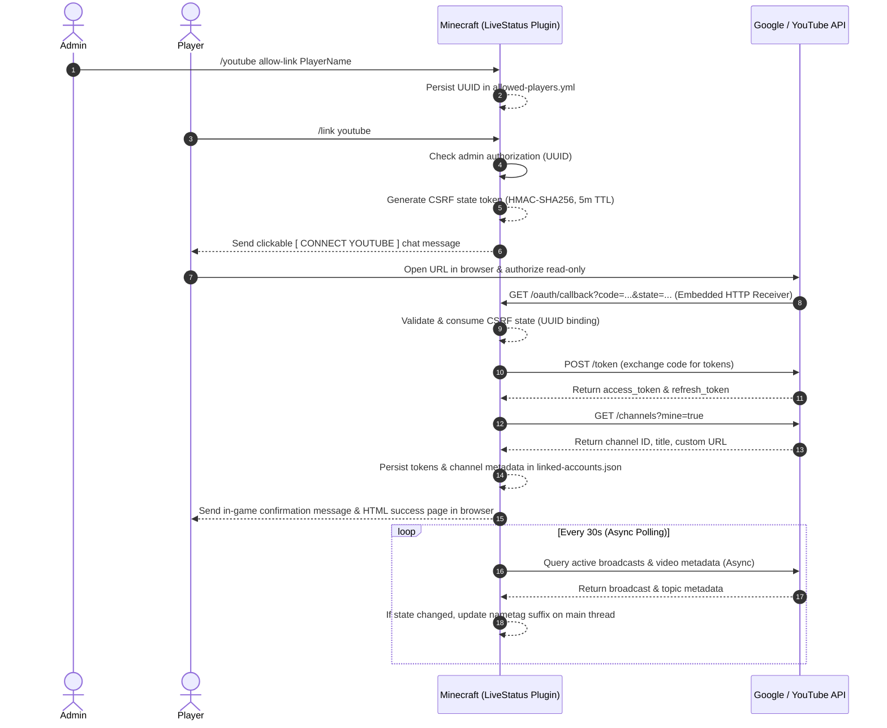

# Google Cloud & YouTube OAuth 2.0 Setup Guide

> **You only need one Paper plugin JAR.**
>
> The Paper plugin contains an embedded, non-blocking OAuth callback receiver. No external backend service is required.

---

## 1. Google Cloud Console Setup

### Step 1: Create a Project
1. Navigate to the [Google Cloud Console](https://console.cloud.google.com/).
2. Click the project dropdown in the top navigation bar and select **New Project**.
3. Name your project (e.g. `Minecraft-LiveStatus`) and click **Create**.

### Step 2: Enable YouTube Data API v3
1. In the navigation menu, go to **APIs & Services** > **Library**.
2. Search for and enable **YouTube Data API v3**.
   *(Note: YouTube Live Streaming API endpoints are bundled under YouTube Data API v3).*

### Step 3: Configure the OAuth Consent Screen
1. Go to **APIs & Services** > **OAuth consent screen**.
2. Choose **External** user type and click **Create**.
3. Fill in required application details:
   - **App name**: `Minecraft Server YouTube Live Connector`
   - **User support email**: Your administrative email.
   - **Developer contact information**: Your contact email.
4. On the **Scopes** page, click **Add or Remove Scopes** and select:
   - `.../auth/youtube.readonly` (`https://www.googleapis.com/auth/youtube.readonly`)
   > [!IMPORTANT]
   > Do **NOT** request write scopes. Only read-only access is needed to inspect active live broadcasts and channel metadata.
5. If the app is in **Testing** status, add your test Google accounts under **Test users**. To allow any player to link their account publicly, submit the app for verification.

### Step 4: Create OAuth 2.0 Client Credentials
1. Go to **APIs & Services** > **Credentials**.
2. Click **Create Credentials** > **OAuth client ID**.
3. Select **Application type**: `Web application`.
4. Name: `LiveStatus Plugin`.
5. Under **Authorized redirect URIs**, add the callback URI matching your plugin's configuration:
   - For local development / testing: `http://localhost:8080/oauth/callback`
   - For production servers: `https://your-server-domain.com/oauth/callback`
6. Click **Create**.
7. Copy the **Client ID** and **Client Secret**.

---

## 2. In-Plugin OAuth Configuration

In `plugins/LiveStatus/config.yml`:

```yaml
youtube:
  client-id: "${YOUTUBE_CLIENT_ID:YOUR_CLIENT_ID.apps.googleusercontent.com}"
  client-secret: "${YOUTUBE_CLIENT_SECRET:YOUR_CLIENT_SECRET}"
  redirect-uri: "http://localhost:8080/oauth/callback"
  callback-port: 8080
  callback-host: "0.0.0.0"
  request-timeout-ms: 5000
```

---

## 3. Self-Contained OAuth Flow Architecture



---

## 4. API Limitations & Stream Detection Strategy

### A. Game Detection: YouTube Studio vs Public Data API
* YouTube's public Data API v3 **does not expose a standalone raw text property** for the internal "Game Title" selected in YouTube Studio Live Control Room.
* Instead, YouTube associates gaming videos with:
  1. `snippet.categoryId = "20"` (Gaming category).
  2. `topicDetails.topicCategories` containing the canonical Wikipedia Knowledge Graph URI: `https://en.wikipedia.org/wiki/Minecraft`.
* **Detection Implementation**: The plugin uses `TopicCategoryDetector`, which verifies `categoryId == "20"` and validates `topicCategories` against `https://en.wikipedia.org/wiki/Minecraft`.
* Streams of other games (e.g. *Grand Theft Auto V*, *Fortnite*, *Valorant*) or *Just Chatting* are detected as `LIVE_NOT_MINECRAFT`. The plugin suppresses the `LIVE` indicator in those cases.

### B. Members-Only Streams
* YouTube Data API v3 does not provide a public `membersOnly` boolean flag. Private and inaccessible broadcasts safely fail closed (`UNKNOWN`), ensuring no false positives.
